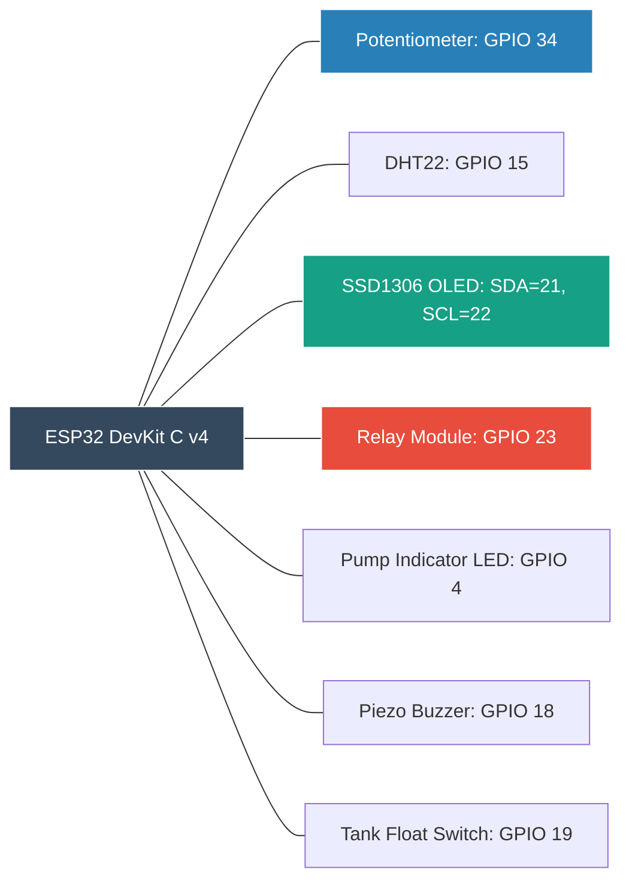

# IoT Smart Plant System: Circuit Schematics & Pinout Guide

This document details the hardware connections, pinout tables, and circuit schematics for both **NodeMCU ESP8266** and **ESP32** implementations.

---

## 1. Hardware Bill of Materials (BOM)

| Item | Component | Specification | Estimated Cost (INR) | Purpose |
| :---: | :--- | :--- | :---: | :--- |
| 1 | **NodeMCU ESP8266** (or ESP32) | CP2102 / CH340, 2.4 GHz Wi-Fi | ₹280 – ₹450 | Edge Controller & Wi-Fi Gateway |
| 2 | **Capacitive Soil Moisture Sensor** | Version 1.2 (Corrosion resistant) | ₹90 – ₹130 | Substrate moisture measurement |
| 3 | **DHT22 / DHT11 Sensor** | Digital relative temp & humidity | ₹120 – ₹250 | Ambient climate monitoring |
| 4 | **1-Channel 5V Relay Module** | Optocoupler isolated, 10A 250VAC | ₹60 – ₹80 | Electrical isolation & pump drive |
| 5 | **Mini Submersible DC Pump** | 3V–5V DC, 120 L/hr | ₹90 – ₹120 | Water delivery actuator |
| 6 | **0.96" I2C OLED Display** | SSD1306 128x64 Blue/White | ₹180 – ₹240 | Local real-time telemetry readout |
| 7 | **Water Float Sensor Switch** | Magnetic reed float switch | ₹70 – ₹90 | Reservoir empty lockout |
| 8 | **Passive Piezo Buzzer & LEDs** | 5V Buzzer, 5mm Blue/Green LEDs | ₹25 | Visual & acoustic alert indicators |
| 9 | **Silicone Tubing & Jumpers** | 6mm ID tube, breadboard wires | ₹60 | Plumbing & electrical connections |
| **Total** | | | **~ ₹950 – ₹1,450** | *Low-cost, accessible IoT project* |

---

## 2. Circuit Wiring Diagram (NodeMCU ESP8266)

```
                       +-----------------------------------+
                       |         NodeMCU ESP8266           |
                       |                                   |
 [Capacitive Sensor]   |                                   |
   VCC --------------> | 3V3                               |
   GND --------------> | GND                               |
   AOUT -------------> | A0                                |
                       |                                   |
 [DHT22 Temp/Hum]      |                                   |
   VCC --------------> | 3V3                               |
   GND --------------> | GND                               |
   DATA -------------> | D2 (GPIO 4)                       |
                       |                                   |
 [5V Relay Module]     |                                   |
   VCC --------------> | VIN (5V USB rail)                 |
   GND --------------> | GND                               |
   IN  --------------> | D1 (GPIO 5)                       |
                       |                                   |
 [OLED SSD1306 I2C]    |                                   |
   VCC --------------> | 3V3                               |
   GND --------------> | GND                               |
   SDA --------------> | D2 (GPIO 4) [Shared/Alt D3]       |
   SCL --------------> | D1 (GPIO 5) [Shared/Alt D4]       |
                       |                                   |
 [Water Float Switch]  |                                   |
   Terminal 1 -------> | D6 (GPIO 12 with Internal PULLUP) |
   Terminal 2 -------> | GND                               |
                       |                                   |
 [Piezo Buzzer]        |                                   |
   Positive (+) -----> | D8 (GPIO 15)                      |
   Negative (-) -----> | GND                               |
                       |                                   |
 [Status LED]          |                                   |
   Anode (via 220R) -> | D7 (GPIO 13)                      |
   Cathode ----------> | GND                               |
                       +-----------------------------------+
```

---

## 3. Water Pump & Relay High-Power Circuit

```
  [External 5V DC Power / USB Supply]
         (+) --------------------+
                                 |
         (-) ---------+          |
                      |          |
                      |    [5V Relay Module]
                      |    +-------------------+
                      |    | COM               |
                      |    |   o---------------+
                      |    |    \ (Normally Open)
                      |    |     \
                      |    | NO   o------------+
                      |    +-------------------+
                      |                        |
                      |                 [DC Water Pump]
                      |                 +-------------+
                      +-----------------| (-)     (+) |
                                        +-------------+
```

### Protection Features:
1. **Optocoupler Isolation:** Isolates microcontroller logic from motor inductive voltage spikes.
2. **Flyback Protection Diode:** Dissipates back-EMF spikes generated when pump motor shuts down.
3. **Power Isolation:** For high-power pumps (12V), power the motor from a separate 12V DC adapter while sharing a common ground (GND) with the ESP.

---

## 4. ESP32 Wokwi Virtual Circuit Layout

In the browser-based Wokwi simulation (`firmware/diagram.json`), components are wired as follows:


